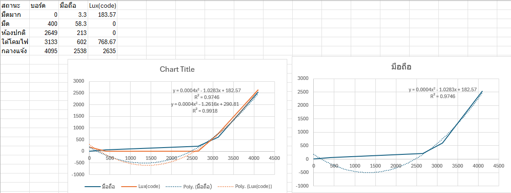

# Lab 5 — คาลิเบรตเซ็นเซอร์แสง LDR

## ค่าที่วัดและเปรียบเทียบ

| สภาพแสง | ADC จากบอร์ด | Lux จากมือถือ | Lux จากโค้ด | คลาดเคลื่อนสัมบูรณ์ (lux) |
|---|---:|---:|---:|---:|
| มืดมาก | 0 | 3.3 | 183.57 | 180.27 |
| มืด | 400 | 58.3 | 0 | 58.30 |
| ห้องปกติ | 2649 | 213 | 0 | 213.00 |
| ใต้โคมไฟ | 3133 | 602 | 768.67 | 166.67 |
| กลางแจ้ง | 4095 | 2538 | 2635 | 97.00 |

ความคลาดเคลื่อนสัมบูรณ์ = |Lux จากโค้ด − Lux จากมือถือ|

## ผลจากกราฟ

สมการแนวโน้มกำลังสองของค่า Lux จากมือถือ ตามตัวเลขที่แสดงบนกราฟ คือ y = 0.0004x² − 1.0283x + 182.57 โดย x คือ ADC และ R² = 0.9746 สัมประสิทธิ์บนกราฟเป็นค่าปัดเศษ ส่วนคอลัมน์ Lux จากโค้ดใช้ค่าที่บันทึกในภาพ

## สรุปผลการทดลอง

เมื่อแสงเพิ่มขึ้น ค่า ADC เพิ่มจาก 0 เป็น 4095 และค่าจากมือถือเพิ่มจาก 3.3 เป็น 2538 lux ค่าจากโค้ดยังต่างจากมือถือ โดยในห้องปกติโค้ดแสดง 0 lux แต่มือถือวัดได้ 213 lux ค่าที่ต่างน้อยที่สุดคือสภาพมืดที่ 58.30 lux ส่วนกลางแจ้งต่างกัน 97 lux ผลจึงบอกว่าแม้กราฟจะมี R² สูง แต่สมการยังประมาณค่าได้ไม่ดีในบางช่วงแสง สำหรับข้อมูลชุดนี้ใช้ห้าสภาพแสงเดิมในการเปรียบเทียบ จึงยังไม่มีผลทดสอบจากสภาพแสงชุดใหม่.

