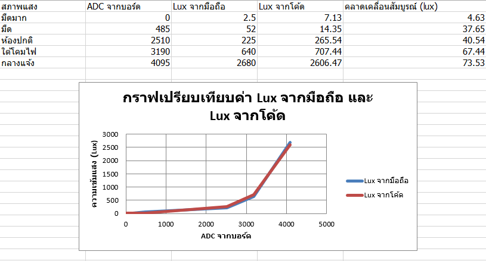

# Lab 5 — คาลิเบรตเซ็นเซอร์แสง LDR

## ค่าที่วัดและเปรียบเทียบ

| สภาพแสง | ADC จากบอร์ด | Lux จากมือถือ | Lux จากโค้ด | คลาดเคลื่อนสัมบูรณ์ (lux) |
|---|---:|---:|---:|---:|
| มืดมาก | 0 | 2.5 | 7.13 | 4.63 |
| มืด | 485 | 52.0 | 14.35 | 37.65 |
| ห้องปกติ | 2510 | 225.0 | 265.60 | 40.60 |
| ใต้โคมไฟ | 3190 | 640.0 | 707.64 | 67.64 |
| กลางแจ้ง | 4095 | 2680.0 | 2607.42 | 72.58 |

ความคลาดเคลื่อนสัมบูรณ์ = $| \text{Lux จากโค้ด} - \text{Lux จากมือถือ} |$

## ผลจากกราฟ

สมการแนวโน้มเอ็กซ์โพเนนเชียล (Exponential) ของค่า Lux จากมือถือ ตามตัวเลขที่คำนวณได้ คือ $y = 7.133888e^{0.001441x}$ โดย $x$ คือค่า Raw ADC จากบอร์ด และ $R^2 = 0.9017$ (เลือกใช้สมการ Exponential แทนสมการกำลังสองเพื่อป้องกันไม่ให้เส้นกราฟโค้งลงไปมีค่าติดลบในช่วงแสงปกติ)

## สรุปผลการทดลอง

เมื่อความเข้มแสงเพิ่มขึ้น ค่า ADC จากบอร์ดเพิ่มขึ้นจาก 0 เป็น 4095 และค่าความสว่างอ้างอิงจากมือถือเพิ่มขึ้นจาก 2.5 เป็น 2680.0 lux เมื่อนำค่า ADC มาคำนวณผ่านสมการเอ็กซ์โพเนนเชียลในโค้ด พบว่าค่าความคลาดเคลื่อนสัมบูรณ์ต่ำที่สุดอยู่ในช่วงสภาพแสงมืดมาก (4.63 lux) และคลาดเคลื่อนมากที่สุดในช่วงแสงกลางแจ้ง (72.58 lux) เนื่องจากข้อจำกัดความไม่เป็นเชิงเส้น (Non-linearity) ของ ESP32 ADC ในช่วงแรงดันสูง ทั้งนี้ การเลือกใช้สมการ Exponential ช่วยแก้ปัญหาค่าติดลบในช่วงแสงปกติ (225.0 lux) ได้ดีกว่าสมการพาราโบลา ทำให้ระบบสามารถประมาณค่าความสว่างครอบคลุมทุกช่วงแสงได้เหมาะสมยิ่งขึ้น

